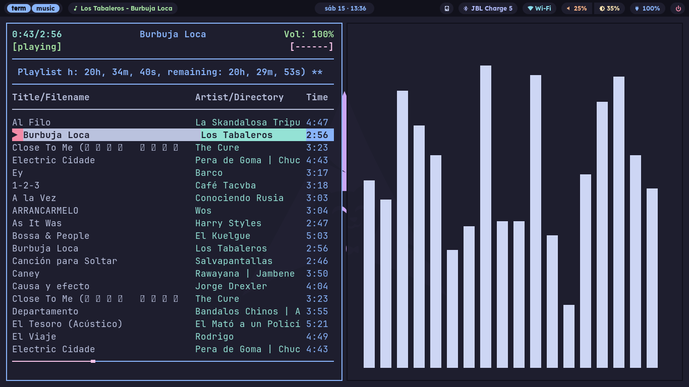

# Conectar Igualdad + Sway

Un escritorio liviano, cuidado y reproducible para Arch Linux, nacido en una
netbook Conectar Igualdad SF20GM7.

El repositorio reúne mi configuración diaria de Sway y las herramientas que la
acompañan: una Waybar informativa, menús simples, música, gestión de discos,
ahorro de energía y servicios de sesión supervisados por systemd. Sigue siendo
mi respaldo personal, pero está organizado y documentado para que otras
personas puedan recorrerlo, reutilizar una parte o instalar el entorno completo.



## Qué vas a encontrar

- **Sway modular**, con atajos y aplicaciones distribuidas por espacios de trabajo.
- **Waybar compacta**, con música, reloj, Bluetooth, red, audio, brillo, batería,
  discos externos y controles de energía.
- **Menús con fuzzel y foot** para redes, Bluetooth, audio, energía, portapapeles y discos.
- **Sesión mantenible**, con Waybar, Mako, swayidle, polkit, luz nocturna y utilidades bajo
  unidades de `systemd --user`.
- **Música y archivos**, con MPD/ncmpcpp, PyRadio, mpv, Yazi y Thunar tematizados.
- **Respaldo y restauración**, con vista previa, copia de seguridad automática,
  rollback y verificaciones posteriores.
- **Piezas opcionales de sistema**, como polkit, iwd, nftables, OpenSSH,
  systemd-boot y ajustes conservadores del kernel.

La estética combina Catppuccin Mocha con Lexend y glifos Nerd Font. El objetivo
no es llenar la pantalla de información, sino mostrar lo útil sin distraer.

## Antes de instalar

Este no es un paquete universal ni una distribución. Es un conjunto de dotfiles
para **Arch Linux + Sway** que refleja decisiones personales y el hardware donde
se desarrolló.

Conviene revisar especialmente:

- los nombres y reglas de workspaces;
- las carpetas XDG en español y la biblioteca `~/Música`;
- la interfaz y el dominio regulatorio de iwd;
- la red confiable `192.168.1.0/24` usada por nftables;
- las entradas de systemd-boot;
- cualquier configuración de SSH antes de aplicarla.

No se incluyen contraseñas, tokens, claves privadas, perfiles Wi-Fi, sesiones de
navegador ni claves SSH autorizadas. OneDrive también requiere vincular la cuenta
localmente después de restaurar.

## Instalación recomendada

### 1. Clonar y revisar

```sh
git clone https://github.com/massisalva/conectar-igualdad-sway.git
cd conectar-igualdad-sway
./restore.sh --help
```

Para ver los cambios sobre tu `$HOME` sin escribir archivos:

```sh
./restore.sh --dry-run
```

### 2. Restaurar solo el entorno de usuario

Este es el punto de partida más seguro. Copia `home/` sobre tu directorio
personal conservando los permisos de los directorios existentes, ajusta los
permisos de los scripts e instala los complementos de Yazi si `ya` ya está
disponible:

```sh
./restore.sh
```

Si MPD está instalado, la restauración también ejecuta
`systemctl --user enable --now mpd.service` para dejar disponible la biblioteca
musical en una cuenta nueva. Si instalaste MPD por separado después de restaurar,
ejecutá ese comando manualmente.

Cada archivo reemplazado se guarda antes en `backups/restore-*`. También se
respaldan los archivos cuyos permisos se ajustan y el modo previo de `~/.ssh`.
Al terminar, podés comprobar el resultado con:

```sh
./check.sh
```

Después iniciá Sway nuevamente o recargá su configuración con `Mod+Shift+c`.

### 3. Instalar paquetes, si los necesitás

Las listas reproducibles están en `docs/pkglist-pacman.txt` y
`docs/pkglist-aur.txt`. Se pueden aplicar por separado:

```sh
./restore.sh --packages
./restore.sh --aur
```

La segunda opción necesita `yay` instalado. Ambas listas representan este
entorno completo; revisalas si solo querés adoptar una parte de la configuración.
Ejecutá `restore.sh` como tu usuario normal (sin `sudo`): el script solicita
privilegios solo para los pasos que los requieren.

### 4. Aplicar cambios del sistema de forma explícita

Las piezas que requieren privilegios no se instalan durante la restauración
normal. Cada una tiene su propia opción:

```sh
./restore.sh --polkit
./restore.sh --iwd
./restore.sh --nftables
./restore.sh --sshd
./restore.sh --sysctl
./restore.sh --zram
./restore.sh --samba
./restore.sh --bootloader
```

`--zram` instala la configuración, pero el generador de systemd la aplica de
forma más segura en el próximo reinicio. No reinicia automáticamente la unidad
en caliente, porque eso puede desplazar temporalmente páginas de la swap.

`--samba` instala `cifs-utils` y el montaje automático de la carpeta compartida de
la Mac mini de casa (`//192.168.1.10/compartido`) en `~/Compartido`: se monta al
entrar y se desmonta tras 10 minutos sin uso. La contraseña de Samba **no está en
el repo**: si falta `/etc/samba/credenciales-mini` (root, 600), el script la pide.

No recomiendo usar `--all` en otra máquina sin haber revisado antes esas
configuraciones. Para inspeccionar el conjunto completo sin aplicarlo:

```sh
./restore.sh --all --dry-run
```

Si ya adaptaste todo a tu equipo:

```sh
./restore.sh --all
./check.sh --system --sudo
```

## Volver atrás

Cada restauración crea un respaldo con manifiesto. Para recuperar el estado
anterior de los archivos:

```sh
./restore.sh --rollback backups/restore-AAAAMMDD-HHMMSS-PID
```

El rollback restaura archivos y los permisos que la restauración cambió; si
alcanzó una configuración del sistema, puede ser necesario recargar o reiniciar
el servicio correspondiente. **No deshace** lo que no es un archivo: paquetes
instalados, servicios habilitados o iniciados (MPD, nftables, sshd…),
preferencias de gsettings ni carpetas creadas. Eso se revierte a mano.

Antes de tocar nada, el rollback valida el manifiesto entero. En `/etc` y
`/boot` solo acepta los destinos exactos del inventario
[`lib/system-files.sh`](lib/system-files.sh); cualquier otra ruta hace rechazar
el rollback completo. Ese mismo inventario define el origen, el destino y los
permisos usados por la instalación y la verificación. También registra el enlace
DNS de `/etc/resolv.conf`; las credenciales de Samba se crean localmente y no
se incluyen como archivos restaurables.

La restauración se niega a empezar si `~/.ssh`, `~/.ssh/authorized_keys` o
`~/.config/streamrip/config.toml` son enlaces simbólicos: les cierra los
permisos, y `chmod` cambiaría el archivo al que apunta el enlace sin que el
rollback pueda recuperarlo.

Con `--sshd`, si `sshd -t` rechaza la configuración nueva, vuelven los archivos
anteriores y sshd no se recarga.

Los scripts antiguos de `~/.local/bin` se conservan por defecto. `--prune`
quita, siempre con respaldo previo, solo los que el proyecto instaló y después
retiró (`docs/local-bin-retired.txt`). Lo que no está en el repo ni en esa
lista se conserva y se informa, porque puede ser tuyo; para no ver el aviso,
sumalo a `docs/local-bin-keep.txt`. Al quitar un script de `home/.local/bin`,
anotalo en la lista de retirados (los tests lo controlan contra el historial).

```sh
./restore.sh --prune --dry-run
./restore.sh --prune
```

## Mapa del repositorio

| Ruta | Contenido |
| --- | --- |
| `home/` | Archivos que se restauran sobre `$HOME` |
| `home/.config/` | Configuración de Sway, Waybar, foot, fuzzel, Mako, Yazi y otras aplicaciones |
| `home/.local/bin/` | Scripts que implementan menús, módulos y comportamiento de la sesión |
| `polkit/` | Reglas locales para discos y energía |
| `iwd/` | Wi-Fi con iwd, Impala y systemd-resolved |
| `nftables/` | Firewall local y acceso desde la LAN confiable |
| `sshd/` | Endurecimiento conservador de OpenSSH |
| `sysctl/` | Ajustes locales del kernel y swappiness |
| `zram/` | Configuración de zram-generator para swap comprimido |
| `samba/` | Unidades de systemd para montar la carpeta compartida de la Mac mini en `~/Compartido` |
| `bootloader/` | Ejemplos de systemd-boot para revisión manual |
| `docs/` | Inventario, decisiones, auditorías, paquetes y notas de recuperación |
| `lib/system-files.sh` | Inventario compartido de archivos de sistema y enlace DNS |
| `tests/` | Pruebas de restauración, inventario y scripts de interfaz |

## Verificación y mantenimiento

Para validar el repositorio (sintaxis, TOML, ShellCheck si está instalado y
todas las pruebas, en carpetas temporales, sin sudo ni sesión gráfica):

```sh
tests/run-all.sh          # agregar --sway para la prueba con Sway sin pantalla
```

La comprobación del equipo es:

```sh
./check.sh
```

`check.sh` compara HEAD con la copia local de la referencia remota: para saber
si hay commits nuevos en el servidor, correr antes `git fetch`. Con `--system`,
lo que no se puede verificar (por ejemplo, por falta de permisos) cuenta como
falla: el resultado solo se certifica si todo se pudo comprobar.

Además de comparar los archivos activos con el repositorio, valida scripts,
JSON de Waybar, dependencias, procesos duplicados, paquetes huérfanos y las
pruebas automatizadas.

Para probar además el selector de fondos con el parser real de Sway, hay una
prueba opcional que inicia un compositor sin pantalla y usa archivos y sockets
temporales, sin conectarse a la sesión actual:

```sh
python tests/test-wallpaper-sway.py
```

Para incluir archivos protegidos y el estado efectivo de servicios del sistema:

```sh
./check.sh --system --sudo
```

Ese modo también revisa SSH, nftables, unidades fallidas, errores del arranque,
puertos TCP en escucha y el estado SMART del disco raíz.

## Notas de uso

- Streamrip ofrece un menú de descargas de Deezer desde el lanzador y abre en
  `3:music`. La instalación con uv, MP3 a 320 kbps y recuperación de la
  configuración se documentan en [docs/streamrip.md](docs/streamrip.md).
- La configuración de OneDrive limita la sincronización a `02 - Linux`, pero no
  guarda credenciales. La cuenta se vincula ejecutando `onedrive` y el servicio
  se habilita con `systemctl --user enable --now onedrive.service`.
- Las claves reales de `authorized_keys` quedan fuera del repositorio. Solo se
  incluye `home/.ssh/authorized_keys.example`.
- El firewall permite LocalSend y SSH únicamente desde la LAN configurada. Hay
  más contexto en `nftables/README.md`.
- La migración a iwd y sus pasos de recuperación están documentados en
  `iwd/README.md`.
- Las decisiones de alcance y los datos que deliberadamente no se versionan se
  explican en `docs/decisiones.md`.

Para agregar un archivo de sistema, registrá una entrada en
`lib/system-files.sh` con `grupo|tipo|origen|destino|modo`. El origen de un archivo
es relativo al repositorio; el de un enlace es su ruta absoluta y el modo es `-`.
Usá destinos exactos, sin comodines. Las pruebas detectan archivos de configuración
sin registrar y comprueban que una entrada nueva llegue al instalador, al rollback
y al verificador. Los comandos para validar o recargar cada servicio permanecen
en sus funciones específicas.

## Adaptarlo y compartir mejoras

Podés tomar el repositorio completo o copiar solo las partes que te resulten
útiles. Para una instalación propia, lo más razonable es hacer un fork, cambiar
las preferencias ligadas al equipo y comenzar con `--dry-run`.

Si encontrás una mejora generalizable, una corrección o una forma más clara de
documentar algo, los issues y pull requests son bienvenidos.

---

Hecho para prolongar la vida útil de una netbook sencilla y mantener un entorno
que pueda reconstruirse sin depender de la memoria.
